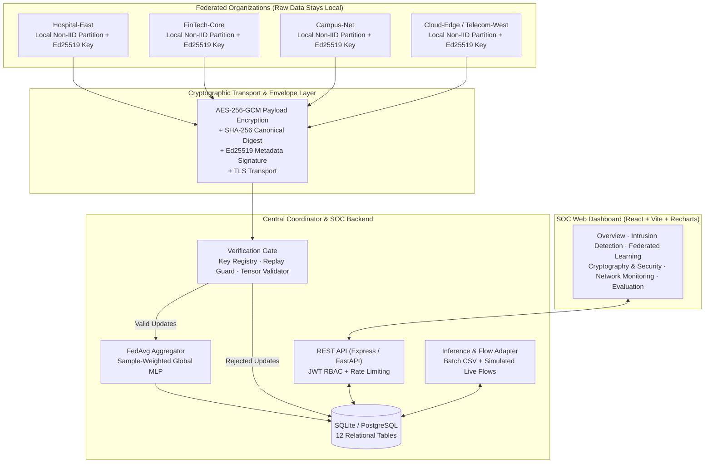
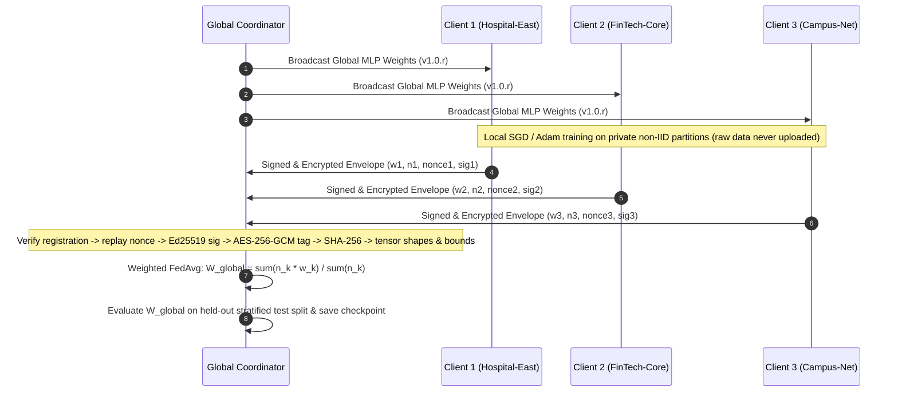
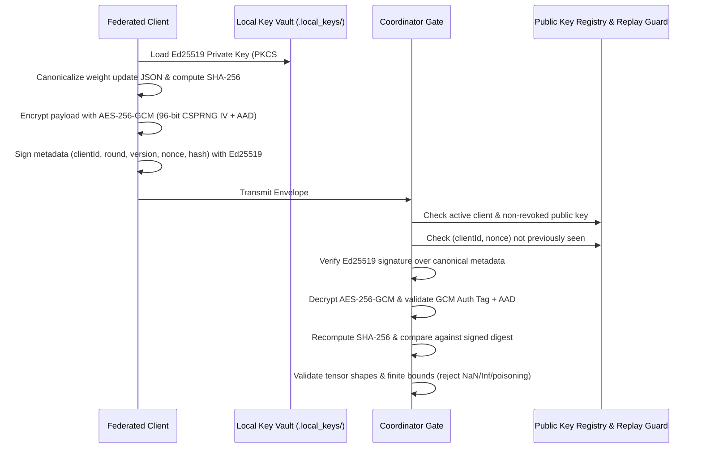

# FL-IDS Architecture, Cryptographic Design & Research Methodology

## 1. System Architecture Diagram

## 2. Federated Learning Workflow Diagram

## 3. Cryptographic Message Flow & Key Lifecycle

### Key Rotation and Revocation Procedure
1. **Provisioning**: Each client generates an Ed25519 key pair locally. Only the SPKI public key and SHA-256 fingerprint are registered with the coordinator; private keys reside in `.local_keys/` (`0600` permissions, excluded from git).
2. **Rotation**: Administrators invoke `POST /api/security/keys/:clientId/rotate` (or `scripts/provision_keys.py`), replacing the active public key fingerprint and recording a `KEY_ROTATED` security event and audit log entry.
3. **Revocation**: Compromised nodes are immediately isolated via `POST /api/security/keys/:clientId/revoke`, marking `revoked = 1`. Subsequent envelopes signed by that key fail at the coordinator gate (`UNAUTHORIZED_CLIENT`).

## 4. Database Schema (12 Tables)

- `roles` (`id`, `name`, `permissions_json`)
- `users` (`id`, `email`, `name`, `password_hash`, `role_id`, `created_at`)
- `datasets` (`id`, `name`, `source_type`, `is_synthetic`, `raw_rows`, `clean_rows`, `dropped_missing`, `dropped_infinite`, `dropped_duplicates`, `removed_leakage_json`, `class_distribution_json`, `feature_columns_json`, `csv_path`, `created_by`, `created_at`)
- `models` (`id`, `name`, `architecture`, `training_paradigm`, `classification_mode`, `version`, `dataset_id`, `accuracy`, `precision_score`, `recall_score`, `f1_score`, `false_positive_rate`, `roc_auc`, `training_time_ms`, `communication_bytes`, `metrics_json`, `artifact_json`, `is_active`, `created_at`)
- `federated_clients` (`id`, `name`, `organization`, `subnet_cidr`, `active`, `last_seen_at`, `created_at`)
- `public_keys` (`id`, `client_id`, `key_id`, `algorithm`, `public_key_pem`, `fingerprint`, `revoked`, `revoked_reason`, `created_at`, `rotated_at`)
- `federated_rounds` (`id`, `job_id`, `round_number`, `model_version`, `classification_mode`, `global_loss`, `global_accuracy`, `global_precision`, `global_recall`, `global_f1`, `global_fpr`, `global_roc_auc`, `participating_clients`, `accepted_clients`, `rejected_clients`, `communication_bytes`, `duration_ms`, `dp_epsilon_estimate`, `metrics_json`, `created_at`)
- `client_metrics` (`id`, `round_id`, `client_id`, `status`, `rejection_reason`, `sample_count`, `local_loss`, `local_accuracy`, `local_f1`, `payload_bytes`, `signature_verified`, `integrity_verified`, `decryption_verified`, `created_at`)
- `security_events` (`id`, `event_type`, `severity`, `client_id`, `description`, `signature_status`, `integrity_status`, `encryption_status`, `blocked`, `created_at`)
- `predictions` (`id`, `batch_id`, `model_id`, `client_sensor`, `ingestion_mode`, `predicted_label`, `true_label`, `is_malicious`, `confidence`, `severity`, `flow_duration`, `flow_bytes_per_sec`, `syn_flag_count`, `created_at`)
- `alerts` (`id`, `prediction_id`, `client_sensor`, `attack_category`, `severity`, `confidence`, `status`, `summary`, `created_at`)
- `audit_logs` (`id`, `actor_email`, `actor_role`, `action`, `resource`, `outcome`, `details`, `created_at`)

## 5. Research Methodology & Honest Security Guarantees

- **Zero Preprocessing Leakage**: `StandardScaler` parameters (`mean`, `std`) are fit exclusively on the training split and applied identically to validation, test, and inference batches. Identifier columns (`Flow ID`, `Source IP`, `Destination IP`, `Timestamp`, `Src Port`) are stripped before feature vectors are constructed.
- **Privacy Distinction**:
  - *Local Training*: Raw flow logs never leave client storage.
  - *Transport & Payload Security*: TLS secures network transport; AES-256-GCM provides application-level confidentiality; SHA-256 ensures integrity; Ed25519 authenticates identity (signatures do not encrypt data; hashing does not provide confidentiality).
  - *Metadata & Gradient Leakage*: Sample counts (`n_k`) and unperturbed gradients can still leak statistical properties to a curious coordinator. Optional DP-SGD gradient clipping and Gaussian noise reduce per-sample memorization at a measurable accuracy trade-off.

## 6. Known Limitations & Future Enhancements

1. **Non-IID Client Drift**: Highly skewed Dirichlet partitions (`alpha < 0.3`) slow FedAvg convergence compared to pooled centralized Random Forest or MLP training; future work can evaluate **FedProx** or **SCAFFOLD** control variates.
2. **Offline CSV vs Live Capture**: Live packet capture requires privileged host network interfaces (`libpcap`/Zeek); the default web console operates safely via offline CSV upload and an explicit simulated flow-adapter feed.
3. **Key Distribution**: Production deployments should replace shared AES master key derivation with per-session **X25519 ECDH** key agreement or hardware-backed KMS / mTLS certificates.

## 7. College Major Project Report Outline

1. Abstract & Problem Statement
2. Literature Review (Centralized IDS vs Federated Learning, CIC-IDS2017, FedAvg, Cryptographic Model Protection)
3. System Architecture & Threat Model
4. Dataset Engineering & Leakage Prevention Methodology
5. Machine Learning & Federated Learning Implementation
6. Cryptographic Protocol Design (Ed25519, AES-256-GCM, SHA-256, Replay Defense, DP-SGD)
7. Experimental Evaluation (Centralized vs Federated Comparison, Non-IID Sensitivity, Communication Overhead)
8. SOC Web Dashboard & Network Security Integration
9. Conclusion, Limitations & Future Scope

## 8. Presentation Outline & Viva Questions

**Presentation Slide Plan (12 Slides)**: Title & Motivation · Threat Model · System Architecture · Dataset & Leakage Prevention · Classical vs Neural Models · FedAvg Workflow · Cryptographic Envelope Flow · Live Dashboard Demo · Centralized vs Federated Results · Non-IID & DP Trade-offs · Testing & Verification · Conclusion.

**Sample Viva Questions**:
1. *Why can't Federated Learning alone guarantee complete data privacy?* — Because unencrypted or unperturbed model updates/gradients and sample counts (`n_k`) can leak membership or attribute statistics under inversion attacks; DP-SGD or Secure Aggregation is needed for formal privacy guarantees.
2. *What is the difference between SHA-256, Ed25519, and AES-256-GCM in your envelope?* — AES-256-GCM provides authenticated confidentiality (encryption + tag), SHA-256 provides a deterministic canonical payload digest for integrity, and Ed25519 provides asymmetric authentication and non-repudiation of the client metadata.
3. *How do you prevent preprocessing data leakage?* — Identifier columns (IPs, Flow IDs, Timestamps) are removed, and `StandardScaler` statistics are fit solely on the training partition.
4. *Why does Random Forest sometimes outperform a 5-round non-IID Federated MLP on tabular flow data?* — Tree ensembles naturally capture axis-aligned thresholds on pooled IID features without communication rounds, whereas FedAvg averages gradient steps across heterogeneous client distributions.
